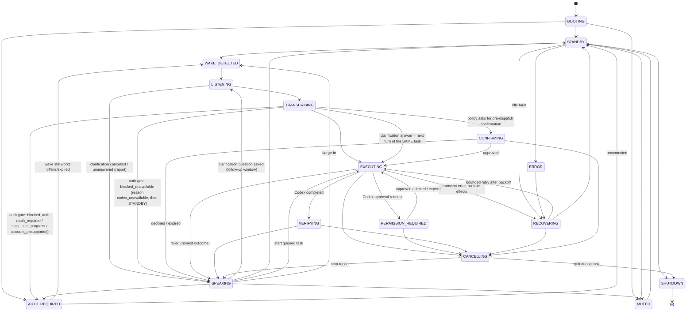

# @dottie/coordinator (E03)

Task lifecycle for Dottie: state machine, shared event contract v2 (CONTRACTS.md, ADR-0012), duplicate prevention, Codex dispatch through an injected port, approvals, bounded retries, recovery and cancellation. It holds no credentials, audio, or tool code.

Stack: TypeScript (strict, `exactOptionalPropertyTypes`, `noUncheckedIndexedAccess`, no `any`), ESM/NodeNext, `tsc` + `node:test`. This matches `src/Dollie_Bot_Private`. There are no runtime dependencies.

```sh
cd packages/coordinator && npm install && npm test   # build + node --test
```

## State diagram



The diagram leaves out some edges. `src/states.ts` `TRANSITIONS` is the authoritative table, and the tests check every from/to pair against it. Key rules:

- **The table is explicit.** Any pair not listed is rejected. A rejected pair is logged at `warn` (`coordinator.transition.rejected`), recorded in `transitions` with `accepted:false`, and never applied. SHUTDOWN is terminal.
- **A running task is never dropped silently.** `EXECUTING/PERMISSION_REQUIRED/VERIFYING` cannot go straight to `STANDBY` or `SHUTDOWN`. They must pass through `CANCELLING` or a reported outcome (`SPEAKING`).
- **The rest state is computed.** It is `MUTED` if muted, else `AUTH_REQUIRED` if sign-in is known to be invalid, else `STANDBY`. If you mute during a task, the mute takes effect when the task ends. Wake is rejected while muted.
- **Barge-in commands while busy skip the wake states.** While a task is active or queued, E05 delivers `UtteranceReady` directly to `submitUtterance` without the wake/listen states. `newTaskPolicy` then decides what happens.

## Event contract v2 (`src/contracts.ts`, CONTRACTS.md §1–§5)

Payload field names follow spec §7 exactly. Every event is wrapped in an envelope with these fields:

`{ schema:'dottie.event', version:2, type, eventId, correlationId, causationId?, taskId?, timestamp(ISO), payload }`

- `correlationId` is a single interaction id that spans wake → utterance → task → response.
- `taskId` on the envelope is used for routing. `ApprovalResolved` needs it because its spec payload has no taskId.
- `validateEvent()` checks untrusted IPC input. It rejects v1 and unknown versions instead of coercing them, and checks the nested `ObservedState` / `ToolError` shapes and the §5 invariants (`error` present exactly when `verified:false`; `retryable:true` only with `sideEffect:'none'`; `TaskFinished.verified:true` only with `succeeded`).

| Event | Payload (spec) | Extensions (need E01 sign-off) |
|---|---|---|
| WakeDetected | timestamp, deviceId, confidence | – |
| UtteranceReady | requestId, text, locale, endReason | `endReason` enum; **`retryOfTaskId?`** (D14, **accepted** by E01): non-empty string. Only the voice or tray retry command sets it; the **main process** strips it from any other origin before the coordinator sees it and writes `input.field_stripped` (E01 ruling 1g/1h). It isn't a `validateEvent` rule, because UtteranceReady has no source field |
| TaskRequested | taskId, requestId, text, threadId?, workspaceScope | workspaceScope = {scopes (§10), paths} |
| TaskProgress | taskId, state, message, toolId?, redactedMetadata | – |
| ApprovalRequested | taskId, actionId, summary, risk, expiry, **category** (11 values, CONTRACTS order: `read, navigate, local_change, delete, overwrite, external_send, external_upload, purchase, install_or_elevate, security_setting, credential_access`) | **actionId = 64 lowercase hex** (§3.3), risk enum, expiry ISO; **`possibleRepeat?: {priorTaskId, priorSideEffect: 'committed' \| 'possible' \| 'unknown'}`** (D14, E01): closed shape (the old `priorOutcome` key is rejected), never with `category` `read` or `navigate` (ruling 1g), `priorTaskId` ≠ `taskId` |
| ApprovalResolved | actionId, approved, timestamp, **decision?: `expired`**, **reason?: `display_unavailable`** (E01 1m/1n) | **actionId = 64 lowercase hex**; envelope `taskId` **required**; a mismatch is rejected (`unknown_action`)  The coordinator emits `{approved:false, decision:'expired'}` on the C-08 timeout, once per dialog (a join opens no second dialog, so it gets no second event); a cancel-settled approval is announced without `decision`. An inbound `decision`, or a `reason` with `approved:true`, is rejected as `invalid_answer` and changes nothing; an inbound `reason:'display_unavailable'` with `approved:false` declines as **display_unavailable**, not as the user's no (E01 1n/2c: the desktop sends it for any ApprovalRequested it can't validate or show, from every source): a Codex request is answered once with `{approved:false, reason:'display_unavailable'}`; a pre-dispatch confirmation ends `TaskFinished declined{approval_unavailable}` (the only `declined` reason in CONTRACTS §3) with zero Codex dispatch and the "couldn't ask for your approval safely" line, never "Okay, I won't do that."; a tool-host actionId has no coordinator dialog (K8 owns those approvals and tokens), so it is rejected `unknown_action` and nothing is emitted or started. The coordinator emits no ApprovalResolved for it, and a later approve is `already_resolved` / `unknown_action`. `validateEvent` rejects `expired`+`approved:true`, `reason`+`approved:true` and `decision`+`reason`. |
| ToolResult | taskId, toolId, observedState: **ObservedState**, verified, error?: **ToolError {code,message,retryable}**, sideEffect, evidenceRef? | taskId is always the coordinator's, never the adapter's or the model's |
| TaskFinished | taskId, outcome, verified, summary, **reason?** | outcome: succeeded, answered, partial, unverified, failed, failed_after_side_effects, declined, blocked_auth, **blocked_unavailable**. `reason?`: with `blocked_auth` one of `auth_required \| sign_in_in_progress \| account_unsupported` (required); with `blocked_unavailable` `codex_unavailable` (required); with `failed` optionally `clarification_timeout \| clarification_cancelled`; with `declined` none (the user declined) or `approval_unavailable` (an approval couldn't be requested); `failed_after_side_effects` may carry any reason from the shared set (CONTRACTS §2.1); other outcomes carry none. `validateEvent` enforces the pairing (CONTRACTS §3, §2.1) |
| TaskCancelled | taskId, stopStatus | **sideEffects, sideEffectsCommitted, committedActions, report** |

## Behaviour

- **Auth gate (DOT-061, fail closed, E01 split 2026-10-19).** Codex is dispatched only after `codex.authState()` returns exactly `signed_in`. Everything else is blocked: `run()` is never called and TaskRequested is never emitted. There are two blocked paths:
  - **Account needs the user → AUTH_REQUIRED, `blocked_auth`** (CONTRACTS §2.1):
    - `signed_out` or `expired` → `reason:'auth_required'`, spoken "reconnect ChatGPT".
    - `signing_in` → `reason:'sign_in_in_progress'`, spoken "finish signing in, then ask me again".
    - `unsupported` → `reason:'account_unsupported'`, spoken "this ChatGPT account can't run Codex; sign out or switch account". This copy never says "reconnect", and repeat notifications never prompt, so there is no reconnect loop. The coordinator never starts a sign-in itself.
    - **Mid-run and after-commit (CONTRACTS §2.1):** a Codex `auth` error during a turn is never retried. It ends `blocked_auth` with `reason:'auth_required'` if the ledger is empty. If anything was committed, or possibly committed (in flight or `unknown`), it ends `failed_after_side_effects` with `reason:'auth_required'` and the actions are reported. Both go to AUTH_REQUIRED.
  - **Codex unavailable → `blocked_unavailable`, `reason:'codex_unavailable'`:** `unavailable`, `unknown`, a synchronous throw, a rejected promise, or no answer within `authReadTimeoutMs` (5 s). It has its own outcome, so the tray can never map it to a sign-in prompt. There is no AUTH_REQUIRED and no sign-in copy ("I can't reach Codex right now…"), and the coordinator returns to STANDBY. The environment condition is the supervisor's `RuntimeStatus` / `waiting_for_env` (CONTRACTS §2.4, ADR-0013, E06), not a coordinator state.
  - If anything was already committed (a later turn or a retry), the outcome is `failed_after_side_effects` instead, with the same reason where it applies.
  - The gate also runs after CONFIRMING, before every retry, and before every clarification turn. A non-`signed_in` notification (`handleAuthChanged`) that arrives while a read is in flight wins over a stale `signed_in`.
  - Boot and notifications follow the same split: sign-in states rest in AUTH_REQUIRED, and Codex-down states rest in STANDBY.
  - Nothing is resumed when sign-in completes or Codex comes back; the user re-issues the command.
  - Each decision is logged as `coordinator.auth_gate {phase, observed, stale, admitted, class}`.
- **`plan_limit`** is never retried and never falls back to an API key. The user is told so.
- **Turns (Rulings 1/2).** Every `CodexPort.run()` is one turn. The coordinator gives it `turnId = <taskId>.t<n>` and `turnKind` (`initial | retry | clarification_answer`). Before a turn starts, the coordinator calls `ToolHostPort.setActiveTurn({taskId, turnId})`; it calls `setActiveTurn(null)` after the turn and `endTask(taskId)` when the task ends.
- **Tool-call context (Ruling 1, E01 ruling 6 + E04).** The tool host asks `authorizeToolCall(toolId, modelArgs)`. A clean call gets the coordinator's `{taskId, turnId}` and the args unchanged. If the args have a top-level **reserved key**, the call is **rejected** (not stripped) with `{ok:false, error:{code:'INVALID_ARGUMENT', retryable:false}, sideEffect:'none'}` and the tool never runs. The reserved keys are `taskId`, `turnId`, `threadId`, `hwnd`, `pid`, and variants: case-insensitive, with `_` or `-` allowed before `Id`, e.g. `task_id`, `TURN-ID`, `HWND`. This matches E04's tool schemas, which are `additionalProperties:false`. Only top-level keys are checked (E01: sufficient). Key names are logged (`coordinator.tool_call.reserved_keys_rejected`), never their values. The reserved-key check runs **before** the active-turn check. Without an active turn, or once a stop was requested, a clean call gets `PRECONDITION_FAILED` (`sideEffect:'none'`). **actionId (E01 DOT-092 ruling 1d, CONTRACTS @ de045c9):** `authorizeToolCall({toolId, modelArgs, actionId})` takes a required host-computed `actionId` (schema → `computeActionId` with `targets`/`threadId`/`itemId` null → authorize). Check 3, after the reserved-key and active-turn checks: missing or not 64 lowercase hex → `DENIED_BY_POLICY` (`sideEffect:'none'`, retryable false, CONTRACTS reason `malformed`), logged as `coordinator.tool_call.action_id_rejected {toolId, reason, missing, taskId, turnId}` with no id or arg values. All actionId judgement is in one method (`checkCallActionId`); the coordinator does not recompute the id (that is K8's, E08), and there is no `checkPolicy` port in the coordinator yet (D8/D10 not in code), so `CheckPolicyParams.actionId` has nowhere to go here. Pending ruling 1e slots into `checkCallActionId`: a K8 `schema_invalid` verdict (the only `actionId:null` case) before the format check, a K8 recompute mismatch (`wrong_action`, incl. a stale host `setActiveTurn` cache) after it. **Preimage rules the coordinator does not enforce (E01 1d clarifications, for K8/E04):** an approval-gated call sends the approval's own `actionId` (the one bound in the K8 token); K8 recomputes it from the tool-call preimage **with `targets` populated**, mismatch → `wrong_action`. For `navigate` and other non-approval calls only `targets` is null; `threadId`, `itemId` and the other CR2 fields are real when known (the test `FakeToolHost` hashes `threadId`/`itemId` as null only because `ToolCallContext` has no `threadId` yet, D1). **Schema (E01 1f, E08 OK):** a schema failure is `INVALID_ARGUMENT`, `sideEffect:'none'`; the message may name the field path and expected type, never the submitted value; a corrected retry is a fresh authorize. The coordinator has no tool schemas (K8/E04 own them); its only schema-like check is the reserved-key rejection, which names keys, never values.
- **Clarification (Ruling 2).** If the turn's last ToolResult has `error.code:'AMBIGUOUS'`, the coordinator speaks `observedState.question` (falling back to Codex's summary). It emits `TaskProgress{state:'LISTENING', redactedMetadata.awaitingClarification:true}` and opens LISTENING. The next utterance continues the **same taskId** on the same thread (`resume:true`) as a new turn, so per-task targetIds stay valid. Dedupe checks only the `requestId` for answers, so a repeated phrase is never swallowed, and answers don't enter the text window. No answer within `clarificationTimeoutMs` (30 s), or a capture abort, ends the task honestly as `failed`, or as `failed_after_side_effects` if actions already ran, with `reason:'clarification_timeout'` for silence or `reason:'clarification_cancelled'` for a capture abort. `maxClarificationTurns` (3) bounds the loop.

- **Duplicate commands.** A repeated `requestId` never creates a second task. The same normalized text inside `dedupeWindowMs` (default 10 s) is also a duplicate; `allowRepeat` overrides this text check only. Codex receives `idempotencyKey = taskId` (stable for the task) and a fresh `turnId` per turn: every retry and every clarification answer gets its own. **The adapter sends `turn/start.clientUserMessageId = turnId`**, carried on the request as `clientUserMessageId` (E01 2026-10-19; this replaces ADR-0010's `= taskId`), as a correlation id. **Codex does not dedupe `clientUserMessageId`** (CONTRACTS §1 L52, §6 item 8: E09 wire run on 0.163.0), so nothing here relies on server idempotency. Idempotency is local and holds on its own:
  - `requestId` and text dedupe in the coordinator;
  - a single active task, with others queued, and at most one `run()` in flight;
  - a retry is dispatched only after the failed run settled;
  - the adapter (E02) enforces one in-flight turn per thread and never starts two Codex turns for one `turnId`.
  A test asserts `maxInFlight === 1` across retries, queueing and duplicate submits.
- **One active task.** A new command while busy is handled by `newTaskPolicy`. With `queue` (the default, `maxQueued` = 1), further commands get `queue_full`. With `cancel_then_start`, the current task is cancelled honestly and the new one starts.
- **Retries (CONTRACTS §1.5, E01 2026-10-19, from E09's wire run on 0.163.0).** The coordinator retries **only** when all of these hold:
  - the failure is a `turn/completed{status:'failed'}` (`CodexError.origin:'turn_failed'`);
  - it is classified `rate_limited` or `transient`;
  - **that turn** started no side-effecting item (`toolStarted{mayHaveSideEffects:true}` or a ToolResult with `sideEffect` ≠ `none`);
  - `attempt < retry.maxAttempts` (default 3, counted per user turn).

  These are never retried:
  - **JSON-RPC errors**, which are always `-32600` with no `data`, e.g. a rejected `turn/start` (`origin:'rpc_error'`). The coordinator treats them as `fatal` whatever `kind` the adapter reports, and logs the misclassification.
  - **Adapter-side failures** (`origin:'adapter'`): a `run()` that throws, or a run aborted without a cancel. These are `fatal`.
  - **`auth`**, including the 401 that arrives as `turn/completed failed httpConnectionFailed{401}` after about 14 s of `willRetry`. It gives `blocked_auth`, or `failed_after_side_effects` if anything was committed, both with `reason:'auth_required'`.
  - **`plan_limit`** and **`fatal`**.

  - **Per-turn vs per-task ledger (E01 2026-10-19).** Retry *eligibility* uses the failed turn's own ledger, read strictly: a started tool that may have side effects blocks the retry even if it later reports `sideEffect:'none'`. The task *outcome* uses the whole task's ledger. So a task that finally fails after an earlier turn committed something (e.g. before a clarification) can still be retried in the later turn, but it ends `failed_after_side_effects` and reports the earlier action. The same holds for `clarification_timeout` and `auth_required` endings.

  Each retry is a new turn with a new `turnId` and `clientUserMessageId` on the same thread. Backoff is exponential (500 ms, 1 s, … capped at 8 s, ±20% jitter), and auth is re-checked before every retry.
- **Codex's own retries (`willRetry`).** The adapter calls `hooks.codexRetrying()` on each `error{willRetry:true}` notification. The coordinator then emits a single `TaskProgress{state:'RECOVERING', message:'Reconnecting…', redactedMetadata:{codexRetrying:true}}` per burst, with no error detail. It is never spoken, and the coordinator's own state stays EXECUTING, because this is Codex retrying, not a coordinator retry. The kind is applied only when the final `turn/completed` comes back through `run()`.
- **Approvals.** Approvals are single-use, bound to an `actionId`, and expire after `approvalTimeoutMs`; an expired approval counts as a denial. Silence never approves. A denial is accepted from any channel. An approval is accepted only from channels allowed by `PolicyPort.acceptsApprovalChannel`, and the fail-closed default allows `secure_ui` only (spec §9.7). Cancelling a task denies its pending approvals.
- **actionId (CONTRACTS §3 / §3.3, ADR-0009 CR1/CR2).** Every actionId is lowercase-hex SHA-256 of the canonical binding with purpose `dottie.actionId.v1`. The coordinator never mints one with `IdSource` (the `'act'` prefix is gone).
  - **Pre-dispatch confirmations** take their id from the injected `ActionIdPort.computeActionId(binding)`. The binding (CONTRACTS §2.1 six-key preimage, E08 co-signed; 1k/1q/1r/1u) is `{purpose:'dottie.actionId.v1', method:'dottie.pre_dispatch_confirmation', args:{summary, risk, category, possibleRepeat, retryOfTaskId, displayHash}, targets:null, taskId, threadId:null, turnId:<the coordinator-minted first turnId>, itemId:null, requestId, displayHash, requestSource:'coordinator'}`. `possibleRepeat` is the shown `priorSideEffect` or null (null on read/navigate or no repeat); `retryOfTaskId` is the utterance's or null; both come only from coordinator state. CR2's top-level `displayHash` is authoritative and byte-equal to `args.displayHash`. `displayHash` comes from `ActionIdPort.computeDisplayHash(display)` (E02's, see below); a missing method, throw or non-hex result means no ApprovalRequested and `declined{approval_unavailable}`. `PRE_DISPATCH_VECTOR_HASH` is re-pinned to E02 895676d (`c95085…6a95`, display `1af454…5a8d`).
  - **Codex approvals** carry the adapter-computed id (E02 hashes the server request's CR2 binding). The coordinator checks it with the same rule.
  - **Fail closed.** If no port is wired (the default), the port throws or rejects, or the output isn't `/^[0-9a-f]{64}$/`, **no ApprovalRequested is emitted**.
    - CR1 ("any failure … in the hash computation … resolves as decline") applies: a confirmation finishes `declined` with `reason:'approval_unavailable'` (CONTRACTS §3) and nothing dispatched, and a Codex request gets `{approved:false, reason:'denied'}`.
    - The copy stays truthful, so it never says "you declined": "Not started: I couldn't request your approval safely, so nothing was done." The spoken line is "I couldn't ask for your approval safely, so I didn't do that."
    - One `warn coordinator.approval.action_id_unavailable {taskId, why}` is logged, where `why` is `no_port | port_threw | invalid_output | invalid_adapter_id`. It carries no args, binding or summary.
- **Possible-repeat retry (D14; tool-host-control DRAFT 8 §4.4/§4.6, E08 ruling 4 addition (2), E01 D14 rulings and 1f/1g; test C-25).** A retry is identified only by `UtteranceReady.retryOfTaskId` (accepted; the main process admits it from voice or tray only, and the coordinator relies on no other origin). The retry is always a new taskId, with its own turns, actionIds and approvals; nothing re-mints. When a task ends, the coordinator remembers its side-effect signal (bounded to 64 tasks, no utterance text). Only tools whose pinned-catalog category is **not** `read` or `navigate` count. The catalog is `PinnedToolCatalog.fromPinned(bytes, sha256)` (`src/toolCatalog.ts`): main hands it the bytes of `packages/contracts/tool-catalog.json` and the pinned SHA-256; on a hash or shape mismatch every lookup is uncategorised. An uncategorised tool (missing from the catalog, no catalog wired, hash mismatch, or a lookup that throws) counts **as class `unknown`** (CONTRACTS 5b6b3f5 §5 h, fail closed): an in-flight one is raised from `possible` to `unknown`, a committed one stays `committed`. The signal is the highest of `committed` > `unknown` > `possible` (E01 1j), else none.
  **Retryable priors (E01 §5 c, CONTRACTS 5b6b3f5/060cd60/e93907c):** `failed`, `failed_after_side_effects`, `unverified`, `partial`, `blocked_unavailable`. Not retryable: `succeeded`, `answered`, cancelled (TaskCancelled), `declined`, `blocked_auth`, any TaskFinished with reason `clarification_timeout`/`clarification_cancelled` (whatever its outcome), and a refused retry itself. A retry of a non-retryable prior starts nothing: it keeps its fresh taskId, makes no Codex call and no TTS, emits no TaskRequested, emits `TaskFinished{outcome:'failed', verified:false, reason:'retry_not_allowed'}` at once and leaves the prior record untouched (`retry_not_allowed` pairs only with `failed`). A retry starts on the prior task's `threadId` (1j a; tray text `'Retry the last task.'`, `endReason:'tray'`). A retryable prior whose signal is none (clean `failed`, `partial`, an empty-ledger `unverified` or `blocked_unavailable`) follows normal policy (1l). If the retried task's signal is set (or the coordinator has no record of it, which fails closed as `unknown`):
  - the retry **always** goes through a pre-dispatch approval, even when `PolicyPort.preDispatchConfirmation` returns null. The policy's confirmation wins if it has one; otherwise category, risk and summary come from the prior task's last approval whose category isn't `read`/`navigate`/`credential_access`, else `local_change`/`high` (ruling 1f b). Approval categories come from the approvals the user saw, never from a catalog lookup, so a failed `categoryOf` can't become the forced category (1l);
  - every ApprovalRequested of the retry task whose category isn't `read`/`navigate` (pre-dispatch and Codex's) carries `possibleRepeat {priorTaskId, priorSideEffect}`;
  - invariant (1f a): `possibleRepeat.priorTaskId` must equal the task's `retryOfTaskId` before ApprovalRequested is emitted; otherwise nothing is emitted and the request is declined;
  - only a `secure_ui` click approves it, whatever the policy allows for the channel;
  - an explicit retry bypasses the same-text dedupe window; a replayed `requestId` is still a duplicate.
  A clean-failure retry (signal none) follows normal policy and gets no forced approval and no `possibleRepeat`. Codex and the model can't set `possibleRepeat`: ApprovalRequested fields are whitelisted, and an adapter-supplied one is logged as `coordinator.input.field_stripped {field:'possibleRepeat', sourceChannel:'codex', reason:'untrusted_origin', taskId}` with no value, actionId or toolId (1i). They also can't start a task, and the §1.5 rule already blocks any automatic retry once the turn ledger is non-empty. Same-session auto-detection is DOT-094 (week 3, `coordinator.repeatDetection`), not here.
- **Joined approvals (CONTRACTS 1j/1k/1o/1p/1t).** All approvals reaching the coordinator are Codex-sourced, with no K8 token. A request for an actionId that already has a dialog for the task, whether open or settled, is answered at once with `{approved:false, reason:'duplicate_request'}`. It is never replayed, it gets a warning log with `joinedTo` and no values, and no copy says the user declined. Only the dialog's first request can be approved, and each request gets exactly one answer. The first `expiresAt` and timer are never extended. On the C-08 timeout the coordinator emits one `ApprovalResolved{approved:false, decision:'expired'}` per dialog, before TaskFinished. The tool-host join behaviour (stored decision, `tool_token.rejected{duplicate_request}`, audit `joinedTo`) is K8's. The 500 ms visible-and-focused Approve timer is E06/UI's.
- **Verification.** "Tool returned OK" is not success. With a `VerifierPort`, the verifier decides (`verified→succeeded`, `partially_verified→partial`, `unverified→unverified`, `failed→failed`, or `failed_after_side_effects` when the ledger is non-empty). Without one, the task succeeds only if every ToolResult is `verified` with no error, and an AMBIGUOUS step that a clarification turn resolved is not counted. A task that used no tools is reported as `answered`.

## Interfaces expected from other owners (`src/ports.ts`)

- **E02, Codex adapter (`CodexPort`).**
  - `authState()` uses the official account state.
  - `run(request, hooks, signal)` streams progress through `hooks`: `threadAssigned`, `progress`, `toolStarted{mayHaveSideEffects}`, `toolResult{sideEffect}`, `requestApproval` → Promise<decision>.
  - `run` returns `completed | failed{kind} | aborted`. It must classify errors as `transient`, `rate_limited`, `auth`, `plan_limit` or `fatal`, and must never submit two Codex turns for one `turnId`.
  - `cancel(taskId)` → `{stopped}` must report `stopped:true` only after the turn **and its tool processes** have actually stopped.
- **E02, contracts (`ActionIdPort`): swapped (DOT-090).** Wire `actionIds: contractsActionIdPort` (`src/actionIdPort.ts`). It calls E02's `computeActionId` / `computeDisplayHash` from `packages/contracts` @ 45129fe (first 895676d, then 2581593 = cc22afb, then 0146c90), **vendored verbatim** in `src/vendor/e02-contracts/` (canonical.ts, display.ts, enums.ts; source SHAs and SHA-256s in `NOTICE.md` / `SHA256SUMS`, checked by a test), so there is no runtime dependency on `@dottie/contracts`. Both throw `CanonicalError` on an invalid binding or display, which the coordinator treats as fail closed. With no port wired, every confirmation still fails closed. E02's vectors (`test/fixtures/e02/vectors.json`, blob `524d2c3`, E02 45129fe) run in `test/e02Vectors.test.ts`: all 23 actionIds, 17 invalid bindings, 43 displays, 9 displayCuts and 62 invalid displays, byte-identical. `test/helpers.ts` `RecordingActionIdPort` wraps the real port only to record bindings (overrides exist for fail-closed tests). **Re-vendoring:** copy the three files from the new E02 commit unchanged, update NOTICE/SHA256SUMS and the vectors, and rerun. Never edit a vendored file; local changes go in `src/display.ts` / `src/actionIdPort.ts`.
- **E04, Windows tools (with E11), `ToolHostPort`.** The host receives `setActiveTurn(ctx|null)` and `endTask(taskId)`. For each call it uses `Coordinator.authorizeToolCall()` (or `toolCallContext()`) and never reads taskId/turnId from model arguments. It must not run a call that `authorizeToolCall` rejected. targetIds are scoped to the taskId: unknown, cross-task or ended → `NOT_FOUND`; malformed → `INVALID_ARGUMENT`.
  - Each tool declares in the tool catalog whether it may have side effects. These declarations feed `toolStarted.mayHaveSideEffects`, and an unknown tool is treated as `true`.
  - Each ToolResult carries `sideEffect` and a real `observedState`.
  - Tools must support cancellation (safe process-tree kill) so E02 can answer `cancel()` truthfully.
  - E11 implements `VerifierPort.verify()`, which checks postconditions such as the Explorer path or a saved file.
- **E08, policy/security (`PolicyPort`).** E08 owns three decisions:
  - `workspaceScopeFor()`: default-deny scopes and paths.
  - `preDispatchConfirmation()`: which requests enter CONFIRMING.
  - `acceptsApprovalChannel()`: which channel may approve which risk.

  E08 also owns log redaction. The coordinator logs ids, states and kinds only, and never logs utterance text or tokens.
- **E05 voice / E06 UI.**
  - E05 sends wake and capture events (`handleWake`, `handleListeningStarted`, `handleCaptureEnded`, `handleCaptureAborted`, `submitUtterance`) and implements `SpeechPort`.
  - E06 implements `EventSink` and calls `resolveApproval`, `setMuted`, `cancelTask`, `stopSpeaking`, `handleAuthChanged` and `shutdown`.
  - **Desktop snapshot (E01 ruling 2g, 90ceed5).** `getState(): CoordinatorSnapshot` = `{state, taskActive, activeTaskId: string | null}` and `onStateChange(listener) → unsubscribe`, the names and shape of E06's `CoordinatorPort` (dottie `feature/E06-runtime-status` 7f022d2, `services/types.ts`). `activeTaskId` is the single active task (ADR-0010): it is set when the task's flow starts, before any of its events (so it is already set while a pre-dispatch approval is pending), and cleared to null **before** that task's `TaskFinished` or `TaskCancelled` is emitted, with listeners notified first, so neither `getState()` inside the emit nor a caching listener ever sees a stale id. `taskActive` is `activeTaskId !== null`. A queued task's terminal event never clears the running task. It is null at boot, in STANDBY and after a refused retry. A throwing listener is logged (`coordinator.snapshot.listener_failed`) and isolated. `get activeTaskId()` (`string | undefined`) is unchanged. **Terminal events (E01 2g.1, 499e61c):** `onTaskFinished(listener)` and `onTaskCancelled(listener)`, each returning an unsubscribe, with separate listener sets and no union: a TaskCancelled never reaches `onTaskFinished` and a TaskFinished never reaches `onTaskCancelled`. Each listener gets the same envelope the `EventSink` got, exactly once. Order per terminal event: clear the active task → `onStateChange` listeners → `EventSink.emit` → `onTaskFinished` / `onTaskCancelled` listeners (so `getState().activeTaskId` is already null inside them). A throwing listener is logged (`coordinator.task_listener.failed`, type and eventId only) and isolated.

## Cancellation semantics

- **`stopSpeaking()`** stops TTS only. The task keeps running and nothing reports it as stopped.
- **`cancelTask()`** moves to CANCELLING, aborts the run, denies pending approvals and calls `codex.cancel`. It then waits up to `cancelAckTimeoutMs` for the cancel ack and for the run to settle.
- **New command while busy** is handled by `newTaskPolicy`.

`TaskCancelled.stopStatus` takes one of these values:

| stopStatus | Meaning |
|---|---|
| `stopped_before_dispatch` | Nothing was sent to Codex. |
| `stopped_no_side_effects` | Codex acknowledged the stop and the ledger is empty. |
| `stopped_after_side_effects` | Codex stopped, but actions had already happened. |
| `stop_unconfirmed` | No ack arrived in time, so the task may still be running. |
| `completed_before_stop` | The task finished before the stop took effect. |

The side-effect ledger feeds three fields:

- `sideEffects` is `none`, `committed`, or `possible`. Calls that were still in flight, or whose outcome was `unknown`, count as `possible`.
- `sideEffectsCommitted` is true only for `committed`.
- `committedActions` lists the actions.

The `report` text is spoken verbatim. It never claims a clean stop or an undo when there were side effects, and `cancelReport()` enforces that even when it is called with an inconsistent status. A side effect reported after the stop is logged at `error` and emitted as a `TaskProgress` warning (`lateAfterStop`), so it is not lost (spec §14 release blocker).

## Spec conflicts / open questions

1. Spec §4 lists MUTED, AUTH_REQUIRED, PERMISSION_REQUIRED, CANCELLING, RECOVERING, ERROR and SHUTDOWN as "additional events". Here they are modelled as **states**, as the E03 ticket asks.
2. Spec §7 has no taskId on `ApprovalResolved` and no correlation fields anywhere. These were added in the envelope rather than by renaming payload fields.
3. `TaskCancelled {taskId, stopStatus}` and `ToolResult` were extended with side-effect fields so that §14 ("no false 'cancelled'") can be enforced. E01 needs to freeze these extensions in `packages/contracts`, which is where this module should move.
4. The spec gives no dedupe window, retry counts, backoff, approval expiry or cancel-ack timeout. The defaults here (10 s / 3 attempts / 500 ms–8 s / 60 s / 3 s) are provisional.
5. Spec §9.11 says new commands are "queued or cancel-then-start according to an explicit rule" but does not choose one. The default here is `queue`. E01 or Gopi should decide.
6. Tray shows an `Offline` state (§13.4) that has no state in the machine. For now, offline tasks fail as `transient` (they retry, then report failure) and idle faults go to RECOVERING. Resolved by E01 on 2026-10-19: there is no coordinator Offline state. If the auth read says Codex is down, the task is blocked with `reason:'codex_unavailable'` and the coordinator stays idle; the tray shows the supervisor's `waiting_for_env` status (ADR-0013, E06).
7. Resuming after reauth or reconnect (§9.12 "resume only where idempotent/approved") is not automatic. Tasks blocked on auth finish as `blocked_auth`, or `blocked_unavailable` when Codex is down.

### Contract deltas in this change (DOT-060 v2 migration + DOT-061 + Rulings 1/2)

- **Events (CONTRACTS v2, already specified there):** `version:2`; snake_case AuthState with `unsupported`; `plan_limit`; the 9 TaskFinished outcomes (incl. `blocked_unavailable`); `ApprovalRequested.category`; `ToolResult.observedState: ObservedState`, `error?: ToolError`, `evidenceRef?`; `ApprovalResolved` needs the envelope `taskId`; the VerificationResult v2 mapping.
- **Coordinator-local, approved by E01 2026-10-19 (CONTRACTS.md text is being updated by E01):**
  - `CodexTaskRequest.turnId` and `.turnKind`, with `attempt` counted per user turn;
  - the adapter rule "one Codex turn per turnId";
  - `ToolHostPort {setActiveTurn, endTask}`, `ToolCallContext {taskId, turnId}` and `Coordinator.authorizeToolCall`;
  - `SubmitResult {kind:'continued'}`;
  - `TaskProgress.redactedMetadata.awaitingClarification`;
  - one new transition, `LISTENING→SPEAKING` (the report after a clarification is cancelled or unanswered); `SPEAKING→LISTENING` already existed. The state list is unchanged and in sync with the desktop copy (16 states);
  - TaskRequested is emitted only after the auth gate admits the task;
  - `TaskFinished.reason?` (`auth_required | sign_in_in_progress | account_unsupported | codex_unavailable | clarification_timeout | clarification_cancelled | approval_unavailable`) and outcome `blocked_unavailable`, both now in CONTRACTS §3 and ADR-0012 §6;
  - **`CodexError.origin: 'turn_failed' | 'rpc_error' | 'adapter'` (required) and `CodexRunHooks.codexRetrying()`** (CONTRACTS §1.5 retry rule; needs E02 to implement them, and E01 to add them to §2.1);
  - `CodexTaskRequest.clientUserMessageId` (= turnId; always set by the coordinator; optional on the wire per CONTRACTS §1 L52 `clientUserMessageId?: turnId`, but Dottie's adapter always sends it);
  - reserved-key rejection (`INVALID_ARGUMENT`, `sideEffect:'none'`) replaces stripping; `ToolCallAuthorization` lost `ignoredKeys` and gained `sideEffect` on rejection;
  - config `authReadTimeoutMs` (5 s), `clarificationTimeoutMs` (30 s) and `maxClarificationTurns` (3), all confirmed by E01.
- **actionId (E01 ruling 2026-10-19; CONTRACTS §3.3, ADR-0009 Accepted):**
  - `ActionIdPort { computeActionId(binding) }` and `ActionIdBinding` (the CR2 preimage) in `ports.ts`, plus `CoordinatorDeps.actionIds?`. When unwired, the coordinator fails closed.
  - `IdSource.next` lost the `'act'` prefix.
  - `validateEvent` requires a 64-lowercase-hex actionId on ApprovalRequested and ApprovalResolved, matching E02's `sha256Hex` check.
  - Codex `CodexApprovalRequest.actionId` must already be 64 hex; otherwise Codex gets a decline and no event is emitted.
  - Pre-dispatch confirmation binding, ruled by E01 in CONTRACTS §2.1: `method:'dottie.pre_dispatch_confirmation'`, `args:{summary,risk,category}`, `requestId`, `turnId` = the coordinator-minted first turnId (also the dispatched turn's turnId and clientUserMessageId), and `threadId`/`itemId`/`targets` null.
  - "Not approvable" finishes `declined` with the new reason `approval_unavailable` (CONTRACTS §3 TaskFinished). `declined` carries no other reason.
  - `APPROVAL_CATEGORIES` matches CONTRACTS §3 exactly: 11 values, adding `navigate` after `read`.
- **Ruling 1d (E01 2026-10-19, E08 confirm; CONTRACTS @ de045c9):** `AuthorizeToolCallParams {toolId, modelArgs, actionId}` (ports.ts); `Coordinator.authorizeToolCall` now takes the params object (was `(toolId, modelArgs)`); new refusal `DENIED_BY_POLICY` for a missing/malformed `actionId`, check 3 after reserved keys and active turn.
- **D14 possible-repeat retry (tool-host-control DRAFT 8; E01 approved D14, shape revised 2026-10-19):**
  - `ApprovalRequested.possibleRepeat?: {priorTaskId: string; priorSideEffect: 'committed' | 'possible' | 'unknown'}` (E01), validated as a closed shape; rejected on `read` and `navigate` (ruling 1g); rejected if `priorTaskId === taskId`.
  - `ToolCatalogPort { categoryOf(toolId) }` + `CoordinatorDeps.toolCatalog?` (new port, for E01: the D14 trigger needs each side-effecting tool's category; backed by the pinned `tool-catalog.json`, P27).
  - `UtteranceReady.retryOfTaskId?: string` (non-empty), **accepted** by E01. The origin check is in main (ruling 1g).
  - `TaskFinished.reason` gains `retry_not_allowed` (with `failed` only) and `UtteranceReady.endReason` gains `tray` (E01 1j; E05/E06 hold their own copies of these enums and must add them). `PinnedToolCatalog` (`src/toolCatalog.ts`) implements `ToolCatalogPort` over the pinned bytes + SHA-256.
  - **Bound approval display (X5; 1k/1l/1m/1o/1r/1t; key names in `src/display.ts` `DISPLAY_KEYS`, settled by E01 ruling 1v as at 3029c7b: `summaryUntrusted` stays and ui_action has no `targetLabel`).** `ApprovalRequested.display` (required) is a union on `kind`: `pre_dispatch` (coordinator), `codex_command` / `codex_file_change` (Codex), `tool` / `ui_action` (tool host / K8; builders exported for K8). `ApprovalRequested.requestSource` (`coordinator | codex | tool_host`, required, from coordinator state only, in CR2). `validateEvent` enforces each kind's fields, no extra fields (except `tool`, whose per-category fields are E02's), the kind/source guard, `ui_action` only for UI-action methods (E01 1y/1z: exactly `^(ui|window)\.[a-z][a-z0-9_]*$`), 500-path and 8 KB limits, and the pre_dispatch consistency rules. Bound fields are never stripped (displayHash covers the raw bytes); `renderBoundText`/`renderCodexCommand` give the 1t rendering (line count, CRLF→LF for display only, visible `\xNN` / `<U+XXXX>` escapes with a hidden-characters badge, tab and trailing-space markers). Only the untrusted slots (`summaryUntrusted`, `reasonUntrusted`, tool `bodyUntrusted`) are stripped, with E02's hidden-character set (adds U+034F, the Hangul fillers, U+17B4/5, U+206A–206F, U+FFF9–FFFB and tag characters; lone surrogates → U+FFFD). Every builder ends with E02's `validateApprovalDisplay` (anything it rejects → display_unavailable), and `validateEvent` runs it too. **Tool keys: settled, E01 1x** (= E02 895676d, unchanged at 2581593): no `detail`; `external_send` body is `bodyUntrusted` (stripped, cut at 200); `delete`/`overwrite` get `fileCount`, `local_change` `itemCount` (filled in from the list); exact key set per category. **UI-action methods: settled, E01 1y/1z**: exactly `^(ui|window)\.[a-z][a-z0-9_]*$` (`UI_ACTION_METHOD_RE`; a bare `ui.`/`window.`, uppercase, a leading digit or any other character is rejected by the builder and `validateEvent`; a method over 64 code points is never cut → `display_unavailable`); `app.*` (launch/terminate) is kind `tool`, and kind `tool` rejects every `ui.`/`window.`-prefixed id. **E01 1z:** delete/overwrite tool displays always carry `paths[]` and `fileCount` (a string: `'1'` for one item, = `paths.length`); a missing `paths`/`fileCount`, a mismatch or a number is rejected. **Coverage rule scoped to kind `tool` (E01 2a, 972d5f4):** `pre_dispatch`, `codex_command` and `codex_file_change` displays are valid for every request category incl. `read`/`navigate` (a Codex read command and a D14 read/navigate retry confirmation get a dialog; C-25: fresh approval, no repeat warning); `ui_action` stays `local_change` or stricter; a `tool`-kind read/navigate display → `display_unavailable`; `credential_access` never has a request. **Re-vendored at E02 0146c90 (on top of 2581593 / cc22afb; pins E01 97e7bc0 + the 1y follow-up):** the vendored validator itself enforces 1z (regex), 2a (kind-scoped coverage), 2b (credential_access for every kind), the never-cut method and the 1y follow-up (kind `tool` rejects any `/^(ui|window)\./i` method), so our former until-re-vendor wrapper is gone and the port is E02's `computeDisplayHash` unwrapped (E02's `canonicalJson` already refuses a non-plain object). **Re-vendored at E02 45129fe (plain data only):** the vendored validators and `computeActionId` / `canonicalJson` accept only plain data (vendored `isPlainObject` / `isPlainArray`: prototype Object.prototype or null, own enumerable data keys, no symbols or getters, dense arrays; `hasOwn` for every key incl. the nested `app`), so **removed** from ours: `plainOwnDisplay` (and its export), the `own()` field reads in `displayProblems`, and the pre_dispatch own-required-key loop. **Kept / added (ours, the vendored code can't see them):** `validateEvent` records and array fields use the vendored `isPlainObject` / `isPlainArray`, and every event is **closed, envelope and payload alike (E01 ruling 2i, CONTRACTS §2.1)**: an unknown own key, incl. `constructor` / `toString` / `valueOf` / `__proto__`, is "not a v2 field", matched by name against the spec list; nested payload objects are closed too, as in E02's validateEvent (`error`, `workspaceScope` {scopes ∈ CapabilityScope, paths}, `committedActions[]` {toolId, observedState|null, certainty}, `candidates[]` {id, label}, `possibleRepeat`); `observedState` admits tool-specific keys only with scalar values. Port results are copied field by field into events, never passed through: the tool result (top level, `error`, `observedState` minus non-scalar extras, logged `coordinator.port_field.dropped` by count) and the policy `workspaceScope`; Codex approval requests and run results were already whitelisted. `test/helpers.ts` `Sink` validates every event any test emits and fails the file on an invalid one. The Codex App Server wire stays tolerant at E02's adapter (its "wire with an extra field still parses" test); `checkField` own reads; a short-circuit in `displayProblems` that returns the vendored issues before our event-level checks read a non-plain display (no getter is ever invoked); `codexDisplay` params and `toolDisplay` fields must be plain data (the builders copy values into a fresh display, where the vendored validator can't see the original). **Ours:** `hasUiActionPrefix` (`/^(ui|window)\./i`, case-insensitive since the 1y follow-up; was case-sensitive, so a tool `UI.x` / `Window.close` got past our builder while E02 2581593 accepted it) in toolDisplay and validateEvent, now duplicated by E02; **own-property-only** lookups (`Object.hasOwn` in toolDisplay's category tables and validateEvent's field reads; inherited display fields are the vendored validator's since 45129fe); the toolCatalog is a `Map` (own entries only); plus the event-level checks the display validator can't see (display.category = event category, kind/source guard, pre_dispatch risk/possibleRepeat/retryOfTaskId consistency). Prototype names (`toString`, `__proto__`, `constructor`, `hasOwnProperty`, …) as category, kind, field key, requestSource or tool id give null / `display_unavailable` / unknown / a validateEvent rejection, never a throw. **E01 2b:** `validateEvent` requires `display.category === payload.category` for **every** kind (E02's five per-kind negative event fixtures are vendored under `test/fixtures/e02/events/invalid/` and run); a Codex approval always opens exactly one dialog or is declined, whatever its category, and the category passes through unchanged (no raise to `local_change`): a Codex read/navigate approval carries `read`/`navigate` on the event and in the hashed display. **Display limits (CONTRACTS §3 Rendering 1r; E02 FINAL values, E01 1v).** **Cut** fields (`DISPLAY_MAX_LENGTH`, in Unicode code points; over the limit the text becomes the first max−1 code points plus `…` U+2026): `summaryUntrusted` 500, `reasonUntrusted` 500, `app.windowTitle` 256, `targetLabel` (tool) 256, `app.appName` 128, `app.processImage` 260. Untrusted slots are stripped first, then cut; bound fields are cut but never stripped. **Never-cut** bounds (`DISPLAY_HARD_LIMITS`; over any of them the display can't be built, so the approval is declined `display_unavailable` with no dialog): `commandLine` 8192 raw UTF-8 bytes; `paths` ≤500 entries, each ≤4096 bytes (Codex and tool displays); `workingDirectory` ≤4096 bytes; `escalation` ≤32 entries, each ≤256 code points; `method` ≤64 code points (never cut since E02 cc22afb / E01 2b: over 64 → `display_unavailable` for tool and ui_action). `validateEvent` rejects any over-length value rather than repairing it. `displayHash` covers the cut, shown text for cut fields and the raw bytes of never-cut fields. Codex approvals: the coordinator builds the display from `CodexApprovalRequest.display` (`{kind:'codex_command', commandLine, workingDirectory, networkAccess:boolean, escalation?:string[], reason?:string}` or `{kind:'codex_file_change', paths:string[], reason?:string}`) through `ApprovalDisplayPort` (default `codexDisplay`); missing, malformed or over the limits means the approval is answered `{approved:false, reason:'display_unavailable'}` with no dialog. **Until E02 supplies these params, every Codex approval is declined.** A joined Codex request (same actionId as an open or settled dialog) is answered `duplicate_request` at once with a `warn coordinator.approval.joined_declined {taskId, actionId, joinedTo, reason, open}` (no values); only the first request can be approved. The 1f invariant also checks `display.retryOfTaskId` against the utterance's (DOT-060 AC 11). The 500 ms Approve timer and rendering/wrapping are E06's.
  - The audit kind `input.field_stripped` (ruling 1h) isn't in the coordinator contracts (no audit kinds here). Main/E06 writes it for `retryOfTaskId`, and K8 writes it for `possibleRepeat`; the coordinator only logs.

